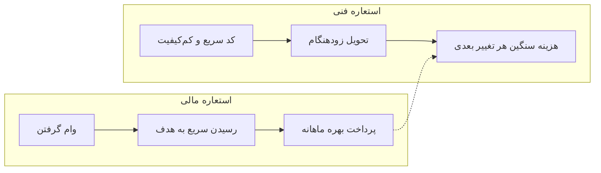
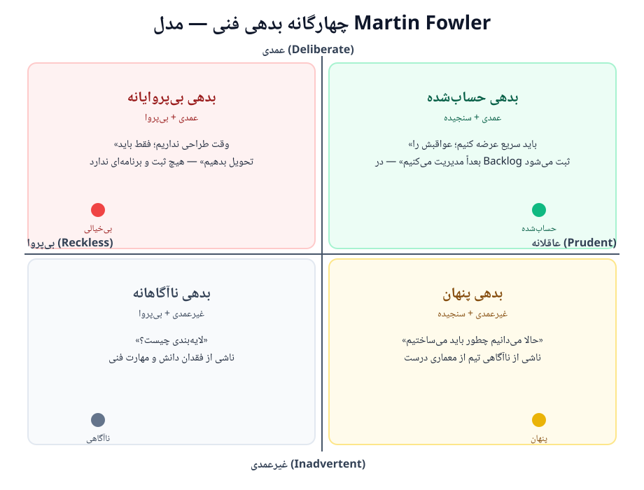
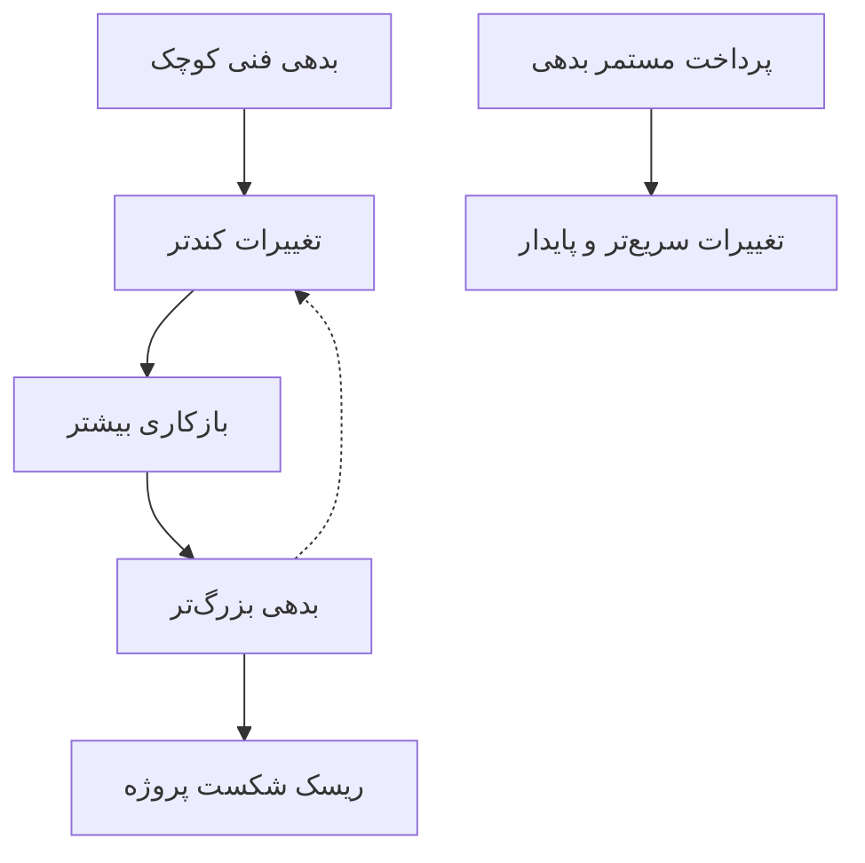

# 🧾 تاپیک ۱ — بدهی فنی (Technical Debt)

> «اگر پولی قرض کنید، می‌توانید سریع‌تر کار کنید — ولی تا وقتی آن را پس ندهید، بهره می‌پردازید.»
> — **Ward Cunningham**، خالق استعاره بدهی فنی (۱۹۹۲)

---

## ۱. چرا اول از بدهی فنی صحبت می‌کنیم؟

قبل از هر چیز در مهندسی نرم‌افزار باید بدانیم چرا «کیفیت» مهم است. بدهی فنی پاسخی است به این پرسش که: **چرا کدهای ما بعد از مدتی «قفل» می‌شوند و هر تغییر جدید سخت‌تر از قبلی است؟**

استعاره بدهی فنی اولین بار توسط **Ward Cunningham** در سال ۱۹۹۲ در کنفرانس OOPSLA (گزارش تجربه سیستم مدیریت پرتفوی WyCash) مطرح شد. او مقایسه کرد بین:

- 💰 **وام مالی**: زودتر به هدف می‌رسید اما باید **بهره** بدهید.
- 🧱 **کد بی‌کیفیت**: سریع‌تر به نسخه اول می‌رسید اما هر تغییر بعدی **گران‌تر** تمام می‌شود.

### تعریف رسمی
بدهی فنی یعنی **هزینه پنهان بازکاری** که به‌خاطر انتخاب راه‌حلِ سریع‌تر (به‌جای راه‌حل درست‌تر) در گذشته به پروژه تحمیل می‌شود؛ هزینه‌ای که با **بهره** (کندی توسعه، باگ‌ها، دشواری تغییر) دیر یا زود دریافت می‌شود.

---

## ۲. انواع بدهی فنی — چهارگانه فاولر (Fowler)

**Martin Fowler** (۲۰۰۳) بدهی فنی را در دو محور دسته‌بندی کرد:

- **نیت (Intent)**: عمدی (Reckless) یا غیرعمدی (Prudent)؟
- **علت**: از روی بی‌احتیاطی بود یا از سر ناچاری و آگاهی؟

| | **عمدی / بی‌پروا (Reckless)** | **عاقلانه / سنجیده (Prudent)** |
|---|---|---|
| **غیرعمدی** | «وقت نداریم کد بزنیم، بعداً درستش می‌کنیم» ولی همه فراموش می‌کنند | تیم نمی‌داند چه معماری درستی است و ناخواسته بدهی می‌سازد |
| **عمدی** | «اصلاً به طراحی فکر نمی‌کنیم، فقط باید تحویل بدهیم» | «الان این راه حل سریع را عمداً برمی‌گزینیم و در Backlog ثبتش می‌کنیم تا بعداً پرداختش کنیم» |

_چهارگانه بدهی فنی: ترکیب «نیت» (عمدی/غیرعمدی) و «احتیاط» (بی‌پروا/عاقلانه) — برگرفته از مدل Martin Fowler_

### دسته‌بندی بر اساس منشأ
| نوع | مثال |
|---|---|
| **کد (Code)** | کپی‌پیست بی‌هدف، توابع بلند، نام‌گذاری بد |
| **معماری (Architecture)** | اتصال سفت‌وسخت ماژول‌ها، نبود لایه‌بندی |
| **طراحی (Design)** | نادیده گرفتن الگوها و اصول SOLID |
| **تست (Test)** | نبود یا کم‌بودن تست خودکار |
| **مستندات (Documentation)** | مستندات قدیمی یا ناقص |
| **زیرساخت (Infrastructure)** | نسخه قدیمی ابزارها، دیپلوی دستی |

---

## ۳. هزینه بدهی فنی در دنیای واقعی

بررسی‌ها و پژوهش‌های صنعت (از جمله گزارش Stripe ۲۰۱۸ و تحلیل‌های CAST/DORA) نشان می‌دهند:

- تیم‌ها به‌طور میانگین **۲۵٪ تا ۴۵٪ از زمان توسعه** را صرف کار روی کدِ مشکل‌دار (نه ویژگی جدید) می‌کنند.
- هزینه سرسام‌آور بازکاری، گاهی تا **۳۰–۴۰٪ هزینه کل پروژه** تخمین زده شده است.
- **بهره بدهی فنی** معمولاً به شکل: باگ‌های مکرر، ریسک امنیتی، کندی انگیزه تیم و جذب نکردن نیروی خوب ظاهر می‌شود.

> ⚠️ دقت کنید: اعداد بالا برآوردهای صنعتی‌اند و بین منابع متفاوت‌اند؛ نکته اصلی **روند** است: بدهی بی‌توجه، تصاعدی رشد می‌کند.

---

## ۴. راه‌های مدیریت بدهی فنی

1. **تشخیص و ثبت**: هر تصمیم «الان سریع، بعداً درست» را در یک لیست (Technical Debt Log / Backlog) ثبت کنید.
2. **اندازه‌گیری**: ابزارهای تحلیل استاتیک کد و متریک‌هایی مثل پیچیدگی سایکلوماتیک، نرخ باگ و زمان چرخه (Cycle Time).
3. **پرداخت مستمر**: مثل وام، بهترین زمان پرداخت «هرچه زودتر» است؛ در هر اسپرینت بخشی از وقت را به بازکاری اختصاص دهید.
4. **اولویت‌بندی**: بدهی‌هایی را اول بپردازید که بهره بیشتری دارند (مناطق پرتغییر کد).
5. **بازآرایی (Refactoring)**: تغییر ساختار بدون تغییر رفتار بیرونی.
6. **جلوگیری**: Code Review، تست خودکار، استاندارد کدنویسی، و مستندات زنده.

### چه‌وقت بدهی «عاقلانه» است؟
- رسیدن به **Deadline حیاتی** کسب‌وکار (مثل انتشار نسخه اولیه برای جذب مشتری یا MVP).
- **آزمایش ایده** که ممکن است اصلاً ادامه پیدا نکند.
- پرداخت کامل بدهی سرِ موقع انجام شود و در Backlog ثبت شده باشد.

---

## ۵. ارتباط با این درس

- در انتخاب **متدولوژی** (تاپیک ۳) خواهید دید که روش‌های چابک، بدهی فنی را با بازخورد مداوم و بازسازی مستمر کنترل می‌کنند.
- در پروژه ترم، هنگام تحویل هر مرحله، یک «ثبت بدهی فنی» داشته باشید و در جلسه بعدی تصمیم بگیرید کدام را می‌پردازید.
- بدهی فنی با **مستندات** هم گره خورده: بدون مستنداتِ به‌روز، دانش تیم از بین می‌رود و بدهی دانش (Knowledge Debt) ایجاد می‌شود.

---

## 📚 منابع
- Cunningham, W. (1992). *The WyCash Portfolio Management System*, OOPSLA Experience Report.
- Fowler, M. (2003). [Technical Debt](https://martinfowler.com/bliki/TechnicalDebt.html).
- McConnell, S. (2007). *Technical Debt*, Cutter IT Journal.
- [The History of Technical Debt: 1992 to Today](https://techdebtcost.com/history) — TechDebtCost.
- [300+ Agile and Scrum Statistics](https://www.parabol.co/resources/agile-statistics/) — Parabol.

---

📎 **بعدی:** [تاپیک ۲ — SDLC](02-sdlc.md)