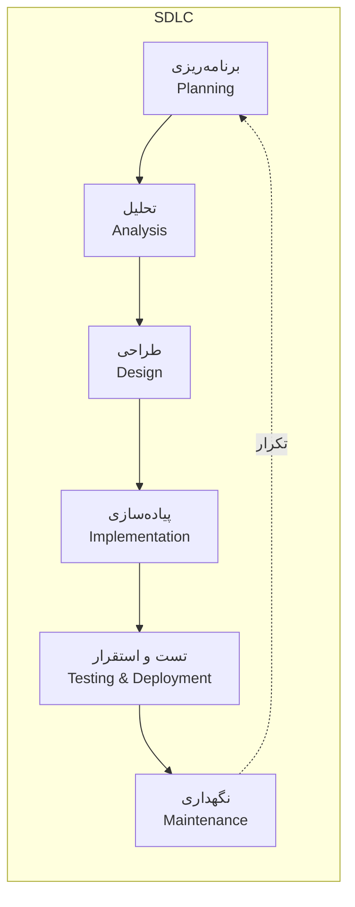
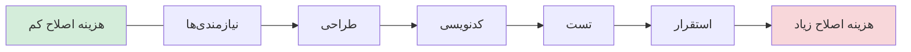

# 🔄 تاپیک ۲ — چرخه حیات توسعه نرم‌افزار (SDLC)

> SDLC چارچوبی است که تمام مراحل ساخت نرم‌افزار — از ایده تا نگهداری — را مشخص می‌کند.

---

## ۱. SDLC چیست؟

**Software Development Life Cycle (SDLC)** مجموعه‌ای ساختاریافته از مراحل است که نرم‌افزار از لحظه ایده‌پردازی تا استقرار و نگهداری طی می‌کند. این چارچوب به تیم‌ها کمک می‌کند:

- تحویل‌دادنی‌های هر مرحله را بشناسند.
- ریسک را مدیریت کنند.
- کیفیت را از ابتدا بسازند، نه اینکه آخر کار «تست» کنند.

> از مطالب ترم قبل (یادداشت جلسه اول «تجزیه و تحلیل و طراحی سیستم‌ها»، منبع Dennis et al. 2022) این چارچوب پایه را مرور می‌کنیم.

---

## ۲. فازهای اصلی SDLC

| فاز | هدف | فعالیت‌های اصلی | تحویل‌دادنی (Deliverable) |
|---|---|---|---|
| **۱. برنامه‌ریزی (Planning)** | تعیین محدوده، زمان، بودجه و تیم | درخواست سیستم، امکان‌سنجی، زمان‌بندی، مدیریت ریسک | سند پروژه، برنامه زمان‌بندی |
| **۲. تحلیل (Analysis)** | فهم دقیق نیازها | گردآوری نیازمندی‌ها، تحلیل فرآیندها، مدل‌سازی Use Case و داده | سند نیازمندی‌ها، مدل‌ها |
| **۳. طراحی (Design)** | مشخص کردن «چگونه ساخته شود» | معماری سیستم، طراحی UI، طراحی پایگاه داده و برنامه | سند طراحی، نمونه اولیه |
| **۴. پیاده‌سازی (Implementation)** | ساخت واقعی نرم‌افزار | کدنویسی، تست واحد، یکپارچه‌سازی ماژول‌ها | کد، نسخه قابل اجرا |
| **۵. تست و استقرار (Testing & Deployment)** | اطمینان از کیفیت و انتقال به محیط عملیاتی | تست سیستم، تست پذیرش، آموزش کاربران، استقرار | گزارش تست، سیستم مستقر |
| **۶. نگهداری (Maintenance)** | پشتیبانی و بهبود در طول عمر | رفع باگ، بهبود کارایی، سازگاری با تغییر محیط | نسخه‌های به‌روز |

---

## ۳. نقش‌ها در فرآیند SDLC

| نقش | وظایف اصلی | فاز غالب |
|---|---|---|
| **تحلیلگر سیستم** | گردآوری و تعریف نیازها، مدل‌سازی | Analysis |
| **مدیر پروژه** | مدیریت زمان، بودجه، منابع، ریسک | Planning |
| **طراح سیستم** | معماری، رابط کاربری، طراحی داده | Design |
| **برنامه‌نویس** | کدنویسی، تست واحد | Implementation |
| **تستر (QA)** | طراحی و اجرای تست، تضمین کیفیت | Testing |
| **کاربر نهایی** | بیان نیازها، تست پذیرش | همه مراحل |

---

## ۴. چرخه حیات پروژه (Project Life Cycle) در برابر SDLC

از یادداشت ترم قبل:

| مرحله چرخه حیات پروژه | فاز متناظر SDLC | فعالیت‌های اصلی |
|---|---|---|
| آغاز (Initiation) | Planning | درخواست سیستم، مطالعه امکان‌سنجی |
| برنامه‌ریزی (Planning) | Planning | زمان‌بندی، مدیریت منابع، انتخاب روش |
| تحلیل و طراحی | Analysis + Design | گردآوری نیازها، مدل‌سازی، معماری |
| توسعه و پیاده‌سازی | Implementation | کدنویسی، تست، انتقال و پشتیبانی |
| پایان و تحویل (Closure) | Implementation | تست نهایی، تأیید، آموزش، انتقال |

> 🔑 **تفاوت:** چرخه حیات پروژه دیدگاه مدیرانه به کل پروژه دارد؛ SDLC دیدگاه فنی به مراحل ساخت نرم‌افزار.

---

## ۵. نکات کلیدی

- **ترتیب خطی، اجرای تکراری**: در عمل فازها همیشه یک‌بار از بالا به پایین اجرا نمی‌شوند؛ در رویکردهای چابک، چرخه‌های کوتاه تکرار می‌شوند.
- **تحویل‌دادنی‌ها پل بین فازها هستند**: خروجی هر فاز، ورودی فاز بعدی است.
- **هم‌راستایی با کسب‌وکار**: موفقیت یعنی پاسخ به نیاز سازمان، نه صرفاً تحویل کد.
- **هرچه دیرتر اشتباه را بفهمیم، هزینه اصلاح بیشتر است** — این همان ارتباط با بدهی فنی است.

---

## ۶. ارتباط با بقیه درس

- SDLC به ما می‌گوید **چه مراحلی** لازم است؛ متدولوژی‌ها (تاپیک ۳) به ما می‌گویند **این مراحل را چطور اجرا کنیم**.
- انتخاب متدولوژی به ماهیت پروژه، قطعیت نیازمندی‌ها، اندازه تیم و بودجه بستگی دارد.

---

## 📚 منابع
- یادداشت ترم قبل: [SAD Lecture Note S1](https://github.com/manp/system-analysis-and-design/blob/master/notes/lectures/SAD%20Lecture%20Note%20S1.md)
- Dennis, Wixom & Roth (2022). *Systems Analysis and Design*, 8th ed., Wiley.
- PMI (2021). *PMBOK® Guide*, 7th ed.

---

📎 **بعدی:** [تاپیک ۳ — متدولوژی‌ها](03-methodologies.md)