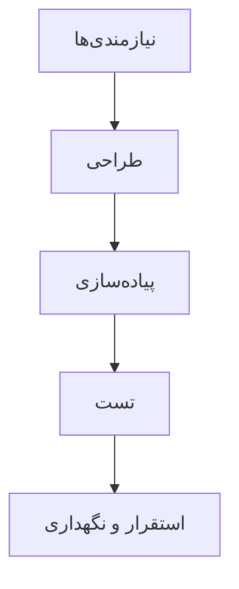
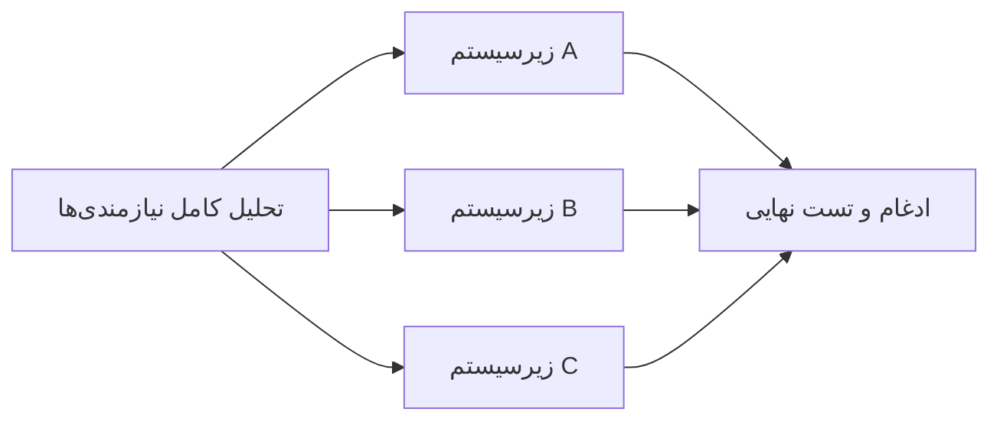
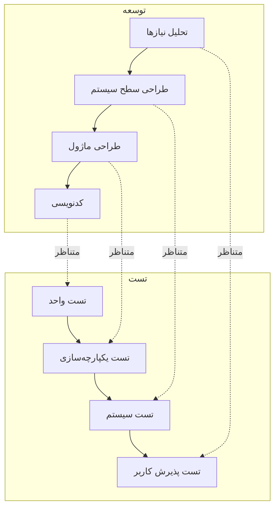

# 🗺 تاپیک ۳ — متدولوژی‌های توسعه نرم‌افزار

> SDLC می‌گوید «چه مراحلی» لازم است؛ متدولوژی می‌گوید «چطور» این مراحل را اجرا کنیم.

---

## ۱. متدولوژی چیست؟

متدولوژی توسعه، **چارچوبی برای سازمان‌دهی، زمان‌بندی و اجرای** مراحل SDLC است. انتخاب متدولوژی مناسب تأثیر مستقیم بر موفقیت پروژه، مدیریت ریسک، کیفیت محصول و رضایت ذینفعان دارد.

متدولوژی‌ها در دو دسته کلی جای می‌گیرند:

- **سنتی/پیش‌بینانه (Predictive)**: برنامه‌ریزی کامل در ابتدا؛ تغییرات گران.
- **تکاملی/تکراری (Adaptive / Iterative)**: انعطاف در برابر تغییر؛ تحویل تدریجی.

---

## ۲. مرور متدولوژی‌های اصلی

### 💧 Waterfall (آبشاری)
قدیمی‌ترین و پایه‌ترین مدل؛ اجرای **خطی و متوالی** فازها — هر فاز فقط پس از تکمیل فاز قبلی شروع می‌شود.



| مزایا | معایب |
|---|---|
| ساختار منظم و قابل پیش‌بینی | انعطاف‌پذیری بسیار پایین در برابر تغییر |
| مناسب نیازهای ثابت و مشخص | مشاهده نتیجه تا اواخر پروژه ممکن نیست |
| مستندسازی کامل | ریسک بالا اگر نیازمندی اولیه غلط باشد |

---

### ⏳ Phased Development (توسعه مرحله‌ای)
تقسیم پروژه بزرگ به **زیرپروژه‌های کوچک**؛ هر فاز نسخه‌ای قابل استفاده تحویل می‌دهد (MVP → v1 → v2).

- ✅ تحویل تدریجی عملکرد، بازخورد زودهنگام، مدیریت بهتر ریسک
- ❌ نیاز به هماهنگی دقیق بین نسخه‌ها، ریسک کاهش انسجام طراحی

---

### ⚡ Parallel Development (توسعه موازی)
برای پروژه‌های بسیار بزرگ: تقسیم به **زیرسیستم‌های مستقل** و توسعه هم‌زمان توسط تیم‌های مختلف.

- ✅ سرعت بسیار بالا در تحویل، استفاده از تخصص‌های مختلف
- ❌ دشواری ادغام نهایی، خطر ناسازگاری ماژول‌ها



---

### 🔬 V-Model
گسترش ساختاریافته آبشاری با تأکید بر **تست و تضمین کیفیت**؛ هر فاز توسعه با یک فاز تست متناظر می‌شود.



- ✅ تمرکز بالا بر QA؛ مناسب سیستم‌های بحرانی (هوافضا، پزشکی، ایمنی)
- ❌ هزینه بالا در صورت تغییر نیازها؛ نیاز به تیم QA متخصص

---

### 🧩 Prototyping (نمونه‌سازی تکاملی)
ساخت سریع **نمونه اولیه** برای روشن کردن نیازهای مبهم؛ نمونه به‌مرور تکامل یافته و به سیستم نهایی تبدیل می‌شود.

- ✅ تعامل مؤثر با کاربر، کشف سریع نیازهای واقعی، کاهش سوءتفاهم
- ❌ بی‌توجهی احتمالی به طراحی نهایی، ریسک تبدیل نمونه بی‌کیفیت به محصول

---

### 🧨 Throwaway Prototyping (نمونه‌سازی دورریختنی)
نمونه فقط برای **درک و تأیید نیازمندی‌ها** ساخته می‌شود و پس از تثبیت نیازها **دور ریخته می‌شود**؛ توسعه اصلی از نو آغاز می‌شود.

- ✅ دقت بالا در تحلیل نیازمندی‌های مبهم، کاهش ریسک ضعف طراحی در سیستم نهایی
- ❌ اتلاف زمان و منابع (دو بار توسعه)

---

### 🚀 Agile (چابک) و اسکرام
تکامل‌یافته مدل‌های تکراری؛ تأکید بر **افراد و تعاملات، پاسخ به تغییر، تحویل تدریجی و بازخورد مستمر**. اسکرام با اسپرینت‌های کوتاه، نقش‌های مشخص (Product Owner، Scrum Master، تیم) و رویدادهای منظم کار می‌کند.

```mermaid
flowchart LR
    subgraph یک اسپرینت (۱–۴ هفته)
        A[Backlog] --> B[برنامه‌ریزی اسپرینت]
        B --> C[توسعه و تست]
        C --> D[بازبینی و بازتاب]
        D --> A
    end
    E[بازخورد مشتری] --> D
```

- ✅ انعطاف بالا، تحویل سریع ارزش، مشارکت مشتری
- ❌ نیاز به تیم بالغ و منضبط، ابهام در تخمین زمان و هزینه نهایی

---

## ۳. جدول مقایسه متدولوژی‌ها

| متدولوژی | نوع پیشرفت | تعامل کاربر | سرعت تحویل نسخه عملیاتی | انعطاف‌پذیری | مناسب برای |
|---|---|---|---|---|---|
| **Waterfall** | خطی | کم | بسیار کم | کم | پروژه‌های کوچک با نیازهای مشخص و پایدار |
| **Phased** | تدریجی | متوسط | متوسط | متوسط | پروژه‌های بزرگ قابل تقسیم به قابلیت‌های هسته |
| **Parallel** | موازی | کم | بالا | متوسط | پروژه‌های خیلی بزرگ با ماژول‌های مستقل |
| **V-Model** | خطی + تست | کم | کم | کم | سیستم‌های بحرانی و ایمنی‌محور |
| **Prototyping** | تکاملی | زیاد | بالا | زیاد | نیازمندی‌های در حال تکامل و نامشخص |
| **Throwaway** | تکاملی (غیرپیوسته) | زیاد | متوسط | زیاد | شناخت دقیق نیازها به‌عنوان مهم‌ترین گام |
| **Agile/Scrum** | تکراری | زیاد | بالا | زیاد | محیط‌های متغیر و تحویل مستمر ارزش |

---

## ۴. چگونه انتخاب کنیم؟

- **نیازمندی‌ها ۱۰۰٪ مشخص و پایدار؟** ← Waterfall یا V-Model
- **نیازمندی‌ها مبهم و نیاز به تعامل زیاد؟** ← Prototyping (تکاملی یا دورریختنی)
- **سیستم بسیار بزرگ و زمان حیاتی؟** ← Parallel یا Phased
- **محیط متغیر و تحویل مستمر؟** ← Agile/Scrum

> ⚠️ هیچ متدولوژی «بهترین» نیست؛ «مناسب‌ترین» را بر اساس قطعیت نیازمندی‌ها، پیچیدگی، زمان و بودجه انتخاب کنید.

---

## ۵. تمرین پیشنهادی

برای پروژه «سیستم مدیریت خوابگاه دانشگاه» (احراز هویت، تخصیص اتاق، ثبت مشکلات فنی، گزارش‌دهی مالی):

1. اگر قوانین تخصیص اتاق به دلیل قوانین متغیر دانشگاه مبهم باشد، کدام متدولوژی برای شروع مناسب است؟ (پاسخ: Throwaway Prototyping)
2. اگر پس از تثبیت قوانین، سیستم ماژول‌های کاملاً مجزا داشته باشد، برای ساخت هم‌زمان آن‌ها چه روشی بهتر است؟ (پاسخ: Parallel Development)

---

## 📚 منابع
- یادداشت ترم قبل: [SAD Lecture Note S2](https://github.com/manp/system-analysis-and-design/blob/master/notes/lectures/SAD%20Lecture%20Note%20S2.md)
- [SDLC Methodologies: From Waterfall to Agile — Virtasant](https://www.virtasant.com/blog/sdlc-methodologies)
- [8 SDLC Methodologies — Relia Software](https://reliasoftware.com/blog/software-development-life-cycle-sdlc-methodologies)
- [300+ Agile and Scrum Statistics — Parabol](https://www.parabol.co/resources/agile-statistics/)
- Dennis, Wixom & Roth (2022). *Systems Analysis and Design*, 8th ed.

---

📎 **برگشت به [صفحه جلسه ۰](index.md)**