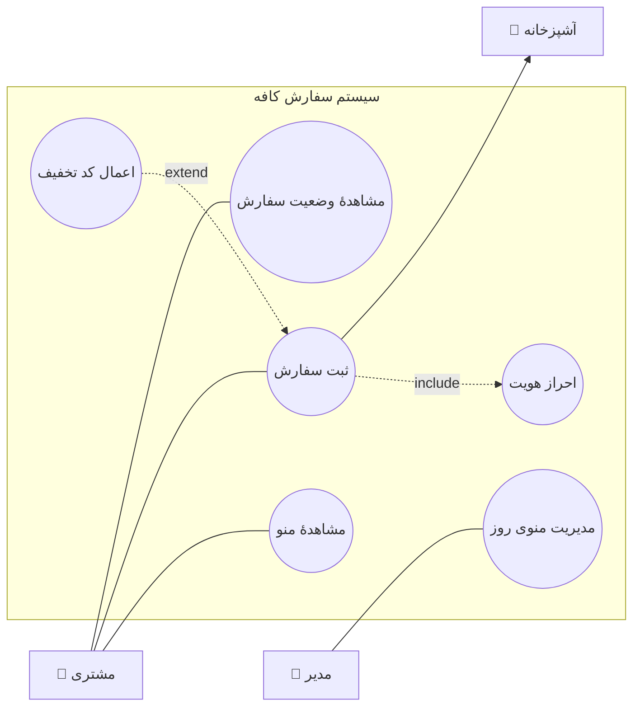

# 🔍 جلسهٔ ۱ — اصول اولیه، مدل‌سازی و نمودار Use Case

📅 **موضوع جلسه:** ورود به فاز تحلیل — از فهم مسئله تا ترسیم نمودار

## 🎯 اهداف جلسه

در پایان این جلسه دانشجو باید بتواند:

1. **تفکر بر اساس اصول اولیه** را توضیح دهد و فرقش را با «کپی از راه‌حل دیگران» بگوید.
2. برای یک مسئلهٔ ساده، **دلیل ساختن مدل** را بیان کند و بداند مدل چه چیزی را ساده می‌کند.
3. تفاوت **نیازمندی عملکردی و غیرعملکردی** را با مثال تشخیص دهد.
4. از یک داستان کاربر، **سناریوی استفاده** بیرون بکشد و آن را به **یوزکیس** تبدیل کند.
5. **نمودار Use Case** را با بازیگر، مرز سیستم، و روابط `include` و `extend` درست رسم کند.

**پیش‌نیاز:** جلسهٔ ۰ (SDLC و جایگاه فاز تحلیل). منبع: Dennis, Wixom, Roth (2022) — فصل‌های ۳ تا ۵.

---

## ۱. شروع مسئله‌محور: سه سؤال قبل از هر خط کد

فرض کنید مشتری می‌گوید: **«می‌خواهم برای کافه‌ام یک برنامه داشته باشم که مشتری‌ها سفارش بدهند.»**

سه نفر سه جواب متفاوت می‌دهند:

| نفر | بلافاصله می‌گوید | نتیجه بعد از دو هفته |
|---|---|---|
| برنامه‌نویس عجول | «یک صفحهٔ منو با دکمهٔ سفارش می‌سازم» | مشتری می‌گوید «من می‌خواستم سر میز با QR سفارش بدهند، نه آنلاین» |
| برنامه‌نویس محافظه‌کار | «چه فناوری؟ چند کاربر؟ موبایل یا وب؟» | سؤالات فنی درست، ولی **مسئلهٔ واقعی** هنوز ناشناخته است |
| تحلیلگر | «الان این کار چطور انجام می‌شود؟ چه کسی اذیت می‌شود؟» | سه سناریو پیدا می‌کند که هیچ‌کدام «دکمهٔ سفارش» نبود |

> 🔑 **درس اول:** مسئله‌ای که مشتری می‌گوید، همیشه مسئله‌ای نیست که باید حل کنی. تفکر بر اساس اصول اولیه یعنی برگشتن به «چه چیزی واقعاً می‌خواهیم» — نه شروع از «چطور بسازم».

---

## ۲. تفکر بر اساس اصول اولیه چیست؟

### تعریف عملی

**تفکر اصول‌گرا** یعنی مسئله را تا سطح حقایق پایه‌ای که قابل انکار نیستند پایین بیاوری، و از آنجا دوباره بالا بیایی. نه اینکه راه‌حل موجود دیگران را با رنگ دیگر بازسازی کنی.

### مقایسهٔ دو رویکرد

| | تفکر قیاسی (Analogical) | تفکر اصول‌گرا (First Principles) |
|---|---|---|
| نقطهٔ شروع | «فلانی چطور حلش کرد؟» | «چه چیزی را باید درست کنیم که بدون آن مسئله حل نمی‌شود؟» |
| سرعت | سریع | کندتر در شروع |
| خطر | کپی کردن فرض‌های پنهان دیگران | دوباره‌کاری چیزهایی که حل شده‌اند |
| کجا خوب است | مسائل تکراری و شناخته‌شده | مسائل تازه، یا جاهایی که راه‌حل موجود بد کار می‌کند |

### چطور در عمل انجامش دهیم — چهار قدم

**قدم ۱ — صورت مسئله را از راه‌حل جدا کن.**
جملهٔ مشتری را بگیر و هر کلمه‌ای که بوی راه‌حل می‌دهد حذف کن.
- «می‌خواهم **اپلیکیشن** سفارش غذا داشته باشم» → «می‌خواهم سفارش غذا دقیق و بدون گم‌شدن ثبت شود»
- «باید **دیتابیس MySQL** داشته باشد» → «اطلاعات باید جایی بماند که خودم کنترلش کنم»

**قدم ۲ — بپرس «چرا» تا پنج بار.**
- چرا سفارش غذا؟ → چون مشتری‌ها سر میز معطل می‌مانند
- چرا معطل می‌مانند؟ → چون گارسون باید برود و برگردد
- چرا این مسئله است؟ → چون در ساعت شلوغی چند میز همزمان سفارش می‌دهند
- **جواب واقعی:** مشکل «کمبود گارسون در ساعت شلوغی» است، نه «نبود اپ»

**قدم ۳ — حقایق پایه‌ای را فهرست کن.**
چیزهایی که بدون آن‌ها مسئله حل نمی‌شود:
- سفارش باید **در لحظه** ثبت شود (نه بعداً)
- باید معلوم باشد **کدام میز** سفارش داده
- آشپزخانه باید **همان لحظه** ببیند

**قدم ۴ — از حقایق به راه‌حل برگرد.**
حالا شاید راه‌حل «اپلیکیشن» باشد، شاید یک تبلت ساده سر هر میز، شاید حتی یک کاغذ با شماره‌گذاری بهتر. **و این تازه تصمیم درستی است.**

> 🔑 **درس دوم:** اصول اولیه تو را به راه‌حل ساده‌تر می‌رساند، نه پیچیده‌تر. اگر بعد از تحلیل، راه‌حل پیچیده‌تر از اول شد، احتمالاً یکی از فرض‌هایت را نسنجیده‌ای.

### یک هشدار: اصول اولیه یعنی «توقف»، نه «نادیده گرفتن تجربه»

تفکر اصول‌گرا به معنی اختراع دوبارهٔ چرخ نیست. یعنی وقتی فرضی را از دیگران می‌گیری، **بدانی که فرض است** و بدانی چرا آنجاست. فرق بین «کپی کردم» و «کپی کردم و می‌دانم چرا اینطور است» همان تفکر اصولی است.

---

## ۳. مدل‌سازی: چرا اصلاً مدل می‌سازیم؟

### مسئله‌ای که مدل حل می‌کند

یک سیستم واقعی، از نزدیک، **بیش از حد پیچیده** است. اگر مستقیم سراغ ساخت بروی:

- نمی‌دانی چیزی را جا انداخته‌ای یا نه
- مشتری نمی‌تواند کد را بخواند و بگوید «این آن چیزی نیست که خواستم»
- وقتی اشتباه معلوم شد، هزینهٔ تغییر چند برابر است

**مدل، یک ساده‌سازی هدفمند از واقعیت است** — نه کپی آن. مدل چیزهایی را عمداً حذف می‌کند تا چیزهای مهم دیده شوند.

### تشبیه: نقشهٔ مترو

نقشهٔ مترو تهران:
- **فاصلهٔ واقعی نیست** (ایستگاه‌ها با فاصلهٔ مساوی کشیده شده‌اند)
- **شکل واقعی خطوط نیست** (خطوط خمیده‌اند)
- **جهت‌های جغرافیایی دقیق نیست**

ولی برای «چطور از تجریش به آزادی بروم؟» **بهتر از نقشهٔ ماهواره‌ای** جواب می‌دهد، چون چیزهای بی‌ربط را حذف کرده.

> 🔑 **درس سوم:** مدل خوب، مدلی نیست که واقعی‌تر باشد؛ مدلی است که برای **سؤالی که داری** جواب بدهد. برای هر سؤال، مدل متفاوتی لازم است.

### چهار مدل برای یک سیستم، هر کدام یک سؤال

| مدل | سؤالی که جواب می‌دهد | مثال در سیستم کافه |
|---|---|---|
| **مدل فرآیند** (نمودار فعالیت) | کارها به چه ترتیبی انجام می‌شوند؟ | مشتری سفارش می‌دهد → آشپز می‌بیند → تحویل |
| **مدل Use Case** | چه کسی چه کاری با سیستم می‌کند؟ | مشتری سفارش می‌دهد؛ گارسون وضعیت را می‌بیند |
| **مدل داده** (ERD) | چه اطلاعاتی ذخیره می‌شود و چه نسبتی دارند؟ | سفارش، میز، آیتم منو |
| **مدل وضعیت** (State) | یک چیز در طول زمان چه حالت‌هایی دارد؟ | سفارش: ثبت‌شده → در حال آماده‌سازی → تحویل‌شده |

هیچ‌کدام «بهتر» از دیگری نیست. هر کدام یک پنجره است.

### قاعدهٔ مدل‌سازی

۱. **مدل قبل از ساخت** — نه به‌جای ساخت، بلکه پیش از آن.
۲. **مدل باید قابل بحث باشد** — اگر مشتری نمی‌تواند روی آن انگشت بگذارد و بگوید «این غلط است»، مدل بدی است.
۳. **مدل باید در سطح درست باشد** — نه آنقدر کلی که چیزی نگوید، نه آنقدر جزئی که کد شود.
۴. **مدل ارزان است، کد گران** — اصلاح یک خط در نمودار ۱۰ دقیقه است، اصلاح در کد دو هفته.

---

## ۴. از مدل به نیازمندی: چه چیزی می‌خواهیم بسازیم؟

قبل از یوزکیس، باید بدانیم سیستم **چه کاری باید بکند** و **چه کاری نباید بکند**.

### دو نوع نیازمندی

| نوع | تعریف | مثال کافه | چطور می‌سنجیم |
|---|---|---|---|
| **عملکردی** (Functional) | سیستم چه کاری **انجام می‌دهد** | سیستم باید سفارش را ثبت کند | «سفارش ثبت شد؟» بله/خیر |
| **غیرعملکردی** (Non-Functional) | سیستم **چطور** کار می‌کند | ثبت سفارش باید زیر ۲ ثانیه باشد | عدد قابل اندازه‌گیری |

> ⚠️ **تلهٔ رایج:** دانشجوها ۹۰٪ نیازمندی‌های عملکردی می‌نویسند و غیرعملکردی را فراموش می‌کنند. بعد سیستم «کار می‌کند» ولی کند است، امن نیست، یا با موبایل درست باز نمی‌شود. **غیرعملکردی‌ها همان چیزهایی هستند که کاربر واقعی اول از همه حسشان می‌کند.**

### معیارهای یک نیازمندی خوب

یک نیازمندی خوب **FURPS+** یا به تعبیر ساده‌تر این هفت ویژگی را دارد:

| معیار | معنی | مثال بد | مثال خوب |
|---|---|---|---|
| **بدون ابهام** | فقط یک تفسیر دارد | «سیستم سریع باشد» | «پاسخ هر صفحه زیر ۲ ثانیه در ۳G» |
| **کامل** | چیزی جا نیفتاده | «سفارش ثبت شود» (بعدش چه؟) | «سفارش ثبت، به آشپزخانه ارسال، و برای مشتری تأیید شود» |
| **سازگار** | با بقیه نمی‌جنگد | «همه چیز آفلاین کار کند» + «آمار زنده از سرور» | انتخاب یکی، با دلیل |
| **قابل آزمون** | می‌شود تستش کرد | «رابط کاربری جذاب باشد» | «۹۰٪ کاربران بدون راهنما سفارش را کامل کنند» |
| **قابل ردیابی** | معلوم است از کجا آمده | «خب این هم خوب است» | «از خواستهٔ ۲ مشتری، صفحهٔ فرم» |
| **امکان‌پذیر** | با منابع موجود شدنی است | «هوش مصنوعی دقیق ۱۰۰٪» | «دقت ۸۵٪ که کاربر بتواند اصلاح کند» |
| **ضروری** | بدون آن مسئله حل نمی‌شود | «دکمهٔ انیمیشنی» | «ثبت سفارش» |

> 🔑 **درس چهارم:** هر نیازمندی باید بتوانی برایش بگویی **«چطور متوجه می‌شویم که انجام شده؟»** اگر جواب نداری، آن نیازمندی نیست — آرزوست.

---

## ۵. مدل‌سازی سناریومحور: از داستان به یوزکیس

### مسیر سه‌مرحله‌ای

```
داستان کاربر  →  سناریوی استفاده  →  یوزکیس  →  نمودار
(چطور می‌گوید)   (چه اتفاقی می‌افتد)  (چه کسی، چه هدفی)  (شکل کلی)
```

### مرحلهٔ ۱ — داستان کاربر (User Story)

قالب استاندارد:

> **«به عنوان [نقش]، می‌خواهم [کار] را انجام دهم تا [هدف/ارزش].»**

مثال:
> به عنوان **مشتری کافه**، می‌خواهم **از سر میز سفارش بدهم** تا **بدون معطل شدن گارسون** غذا بگیرم.

 داستان کاربر:
- **کوتاه** است — یک جمله
- **هدف** را می‌گوید، نه راه‌حل را
- برای **اولویت‌بندی و برنامه‌ریزی** خوب است

 داستان کاربر:
- **جزئیات کافی برای ساخت ندارد**
- نمی‌گوید اگر پرداخت ناموفق بود چه شود

**برای همین به لایهٔ بعد نیاز داریم.**

### مرحلهٔ ۲ — سناریوی استفاده

سناریو، **روایت قدم‌به‌قدم** یک بار استفاده است. برای «سفارش از سر میز»:

**سناریوی اصلی (مسیر موفق):**
1. مشتری QR روی میز را با گوشی اسکن می‌کند
2. منوی روز روی صفحه می‌آید
3. دو آیتم انتخاب می‌کند و «ثبت سفارش» می‌زند
4. پیام «سفارش شما ثبت شد، حدود ۱۵ دقیقه» می‌بیند
5. آشپزخانه سفارش را در صف می‌بیند و آماده‌سازی می‌کند

**سناریوهای جایگزین (چیزی غیرمنتظره می‌شود):**

| حالت | چه اتفاقی می‌افتد |
|---|---|
| منوی روز هنوز آماده نیست | پیام «منو تا ساعت ۱۱ منتشر می‌شود» نشان داده شود |
| مشتری همان آیتم را دوباره می‌زند | پیام «همین آیتم قبلاً ثبت شده، باز هم اضافه شود؟» |
| اینترنت قطع شد وسط ثبت | سفارش در حافظهٔ گوشی بماند، با اتصال دوباره ارسال شود |

**سناریوهای استثنا (خطا):**
- آیتم تمام شده است → باید از منو حذف شود و به کاربر گفته شود
- سرور در دسترس نیست → تلاش دوباره با پیام روشن

> ⚠️ **تلهٔ رایج:** دانشجوها فقط «مسیر موفق» را می‌نویسند. **سناریوهای جایگزین همان جایی است که سیستم واقعی ساخته می‌شود.** بیشتر کد یک پروژهٔ واقعی برای مسیرهای خطا صرف می‌شود، نه مسیر اصلی.

### مرحلهٔ ۳ — یوزکیس

**یوزکیس** یک سناریوی استفاده است که **نام دارد، بازیگر دارد، و هدف مشخصی دارد**.

قالب استاندارد یوزکیس:

| فیلد | مقدار (مثال) |
|---|---|
| **نام** | ثبت سفارش از سر میز |
| **بازیگر اولیه** | مشتری |
| **بازیگرهای ثانویه** | آشپزخانه (گیرندهٔ سفارش) |
| **هدف** | مشتری سفارش می‌دهد و تأیید می‌گیرد |
| **پیش‌شرط** | مشتری سر میز است، QR در دسترس است، منو منتشر شده |
| **محرک (Trigger)** | مشتری «ثبت سفارش» را می‌زند |
| **سناریوی اصلی** | پنج قدم بالا |
| **سناریوهای جایگزین** | جدول بالا |
| **پس‌شرط** | سفارش در سیستم ثبت و به آشپزخانه ارسال شد |

> 🔑 **درس پنجم:** یوزکیس **هدف** را می‌گوید، نه قدم‌های فنی را. «ورود نام کاربری و رمز» یوزکیس نیست؛ «احراز هویت» یوزکیس است. اگر اسم یوزکیس‌ات یک دکمه یا یک صفحه است، هنوز یوزکیس نداری.

---

## ۶. نمودار Use Case در UML

### اجزای نمودار

**۱. بازیگر (Actor)** — یک آدمک، بیرون از مرز سیستم
- **اولیه (Primary):** کسی که هدف را دارد و استفاده را شروع می‌کند → مشتری
- **ثانویه (Secondary):** کسی/چیزی که کمک می‌کند ولی استفاده را شروع نمی‌کند → درگاه پرداخت، آشپزخانه

**۲. مرز سیستم (System Boundary)** — یک مستطیل که دور یوزکیس‌ها کشیده می‌شود. **بازیگرها بیرون آن هستند.**

**۳. یوزکیس** — یک بیضی با فعل + مفعول: «ثبت سفارش»، «مشاهدهٔ منو»

**۴. ارتباط (Association)** — خط ساده بین بازیگر و یوزکیس

**۵. رابطهٔ `include`** — یوزکیس A همیشه یوزکیس B را صدا می‌زند. **اجباری است.**
مثال: «ثبت سفارش» همیشه «احراز هویت» را صدا می‌زند (اگر ورود لازم باشد).

**۶. رابطهٔ `extend`** — یوزکیس B گاهی در یوزکیس A دخالت می‌کند. **اختیاری است.**
مثال: «اعمال کد تخفیف» گاهی در «ثبت سفارش» اتفاق می‌افتد.

> ⚠️ **اشتباه رایج در نمره‌دهی:** `include` و `extend` را برعکس می‌نویسند. یادت باشد:
> - `include` = **همیشه** بخشی از کار است → **اجباری**
> - `extend` = **گاهی** اضافه می‌شود → **اختیاری**
>
> راه حفظ کردن: یوزکیسی که **متفاوت** و **اختیاری** است، از یوزکیس اصلی `extend` می‌کند.

### نمودار سیستم کافه



**بخوان این نمودار را:**
- مرز سیستم مستطیل است؛ هر سه بازیگر **بیرون** آن‌اند.
- مشتری با سه یوزکیس ارتباط دارد (خط ساده).
- `ثبت سفارش` **همیشه** احراز هویت لازم دارد → `include`.
- `اعمال کد تخفیف` **گاهی** اتفاق می‌افتد → `extend`.
- آشپزخانه بازیگر ثانویه است: استفاده را شروع نمی‌کند، ولی نتیجه به او می‌رسد.

### نمودار را چطور بکشیم

| ابزار | مناسب برای | نکته |
|---|---|---|
| **draw.io** (رایگان، وب) | نمودار رسمی برای تحویل | قالب UML دارد، خروجی SVG/PNG |
| **PlantUML** (متنی) | وقتی می‌خواهی نمودار در گیت باشد | با کد نوشته می‌شود، دیف‌پذیر است |
| **StarUML / Visual Paradigm** | پروژه‌های بزرگ | سنگین‌تر |
| **Mermaid** | در Markdown همین مخزن | برای نمودارهای ساده کافی است |

برای این درس **draw.io** کافی است؛ اگر با گیت راحت هستی، PlantUML بهتر است چون نمودار در تاریخچه می‌ماند.

---

## ۷. تمرین کلاسی — ۲۵ دقیقه

**سناریو:** یک کتابخانهٔ دانشگاهی می‌خواهد سیستم امانت کتاب داشته باشد.

با نفر کناری‌ات کار کن و این چهار قدم را انجام بده:

**۱.** سه بازیگر را فهرست کن. (راهنما: یکی از آن‌ها «کتابدار» است، ولی حداقل یکی دیگر هم هست که عجیب به نظر می‌رسد.)

**۲.** سه یوزکیس برای هر بازیگر اصلی بنویس — با **فعل + مفعول**، نه اسم صفحه.

**۳.** یک یوزکیس را انتخاب کن و سناریوی اصلی‌اش را در پنج قدم بنویس.

**۴.** دو سناریوی جایگزین برای همان بنویس. (راهنما: یک مورد دربارهٔ کتابی که قبلاً امانت رفته، یکی دربارهٔ مهلت.)

بعد با هم مقایسه می‌کنیم — انتظار دارم ببینم چند نفر `include` را با `extend` قاطی کرده‌اند. **این اشتباه ارزشمند است، چون نشان می‌دهد کجا باید دقت کنی.**

---

## ۸. جمع‌بندی: پنج چیزی که از این جلسه می‌بری

| اصل | در یک جمله |
|---|---|
| **آغاز از اصول** | صورت مسئله را از راه‌حل جدا کن؛ بپرس «چرا» تا برسی به حقیقت پایه‌ای |
| **مدل = ساده‌سازی هدفمند** | مدل خوب برای یک سؤال جواب می‌دهد، نه همهٔ سؤالات |
| **نیازمندی آزمون‌پذیر** | اگر نمی‌توانی بگویی «چطور می‌فهمیم انجام شد»، نیازمندی نیست |
| **سناریو، نه فقط مسیر موفق** | جایگزین‌ها و استثناها همان جایی است که سیستم واقعی ساخته می‌شود |
| **یوزکیس هدف است، نه صفحه** | «احراز هویت» یوزکیس است؛ «صفحهٔ لاگین» نیست |

---

## 📝 خودآزمایی

۱. تفکر اصول‌گرا را در سه جمله توضیح بده. چرا گاهی کندتر از کپی کردن است، و چه وقت ارزشش را دارد؟

۲. مشتری می‌گوید «می‌خواهم سیستم گزارش‌گیری خوبی داشته باشد». این جمله چه ایرادی دارد و چطور آن را به یک نیازمندی خوب تبدیل می‌کنی؟

۳. فرق `include` و `extend` را با یک مثال از خودت بگو — نه از مثال کافه.

۴. یک یوزکیس از تمرین کلاسی را بردار و بگو اگر این یوزکیس **وجود نداشت**، کدام هدف کاربر شکسته می‌شد.

۵. چرا مدل خوب، مدلی نیست که واقعی‌تر باشد؟ یک مثال بزن که در آن مدل **ساده‌تر** بهتر جواب می‌دهد.

---

## 🎯 تکلیف جلسهٔ بعد

یک سیستم از زندگی خودت انتخاب کن (کتابخانه، فروشگاه، باشگاه، اپلیکیشن دلخواه) و برای آن:

1. **یک نمودار Use Case** با حداقل سه بازیگر و پنج یوزکیس رسم کن — با `include` یا `extend` حداقل یک جا.
2. برای **یک** یوزکیس، جدول کامل بنویس (نام، بازیگر، پیش‌شرط، محرک، سناریوی اصلی، دو جایگزین، پس‌شرط).
3. توضیح بده چرا یکی از یوزکیس‌هایت را **حذف** کردی — یعنی چه چیزی را داخل سیستم نگذاشتی و چرا.

عدد ۳ مهم‌ترین است: **مرز سیستم** را انتخاب کردن، سخت‌تر از یوزکیس نوشتن است.

فایل را به `specification/05-use-case.md` در رپازیتوری پروژهٔ خود اضافه کن و در ربات تحویل بده.

---

## 📚 منابع

- **Dennis, Wixom, Roth** (2022). *Systems Analysis and Design*, 8th ed. — فصل ۳ (مدل‌سازی فرآیند) و فصل ۴ (یوزکیس)
- **Pressman & Maxim** (2020). *Software Engineering: A Practitioner's Approach*, 9th ed. — فصل ۸ (فهم نیازمندی‌ها)
- **Cockburn, A.** (2000). *Writing Effective Use Cases* — مرجع کلاسیک نوشتن یوزکیس
- **OMG UML 2.5** — مشخصات رسمی نمودار یوزکیس
